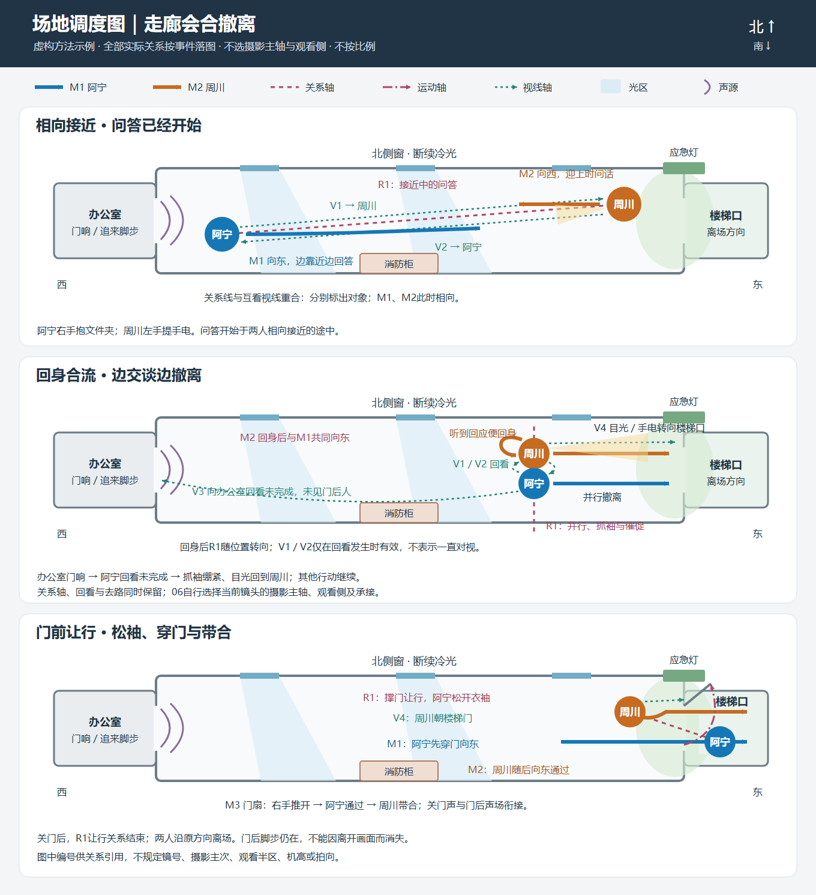

# 04｜声画走戏与听觉设计

**输入与单测**　正式制作取已确认的 02 台本与拍法，并引用03已审身份母本及本场剧情造型／状态、场景区域和道具原件，母本展示服不作为出演服装。单测可直接给一场戏的人物、动作、台词和想让观众经历的变化。以本段要传达的情绪排人、光和声音。环境未细写时，从已有动作或场所功能找可信声源，再选哪层声要突出、退下或留白。

已确认的资产图提供身份、外观与场地设计依据；发现人物妆造或场景需求未定时，交03先问用户，受影响部分待明确后继续，不用现场布置替代资产定型。本场实际摆放、姿态和物件状态由走戏统一落实。承接前场或前章时注明沿用的状态来源；确需改变已定关系时，写清改变的原因和发生时刻。

只用当前项目或用户指定的测试材料，等价输入可直接代替上游稿。缺关键材料或需变更已确认的上游决定时，合并说明缺项或影响，停在本步。只维护本步交付，方法中的教学示例另行虚构。

**本步交付由图主导空间、文字主导连续发生的戏。** 先确定场景空间与人物调度、表演，再按已采用台本及完整走戏画全实际产生的关系轴、视线轴、运动轴及其变化。空间图必须实际绘制并随稿显示；自然语言写清动作、话语、反应、声光变化怎样共同推进，不用说明文字代替图，也不把图上的位置关系再抄成一篇布置说明。

**04画全现场轴线，06决定采用哪条轴怎样拍。** 同一场戏的每个连续阶段都能找到当时全部实际关系及其成立事件。04不选摄影主轴、不圈定观看侧、不画摄影机或预定拍向、银幕左右和换侧方案；场内真实障碍与可通行处仍需交清，02已采用高阶方案所需通路照实落实。06依据02拍法、04现场和05剪辑选择摄影主轴、观看侧、机位及方向衔接，不能挪人、镜像现场或改变行动来迁就画框。现场关系的变化不等于已经设计了摄影换轴。

按[分镜设计职责与交接](../novel-director-06/references/分镜设计职责与交接.md)主动补齐现场依据：谁看谁或看哪件东西、视线是否被挡、说话与反应是否同时发生、持物手与关键接触怎样变化、画外的人和物推进到哪里。02采用严格POV、近远同时可辨、反射／透射或光影揭示时，04落实其真实对象、遮挡、介质和光源关系。04决定现场可见条件，06决定画框中实际清晰范围，不用“起雾／变暗”代替未定的景深。

**不交量化的空间参数。** 图和正文都用相对关系、地标、通路、遮挡和接触表达调度，不写“相距5米”、坐标、角度、机高、步数、照度或比例尺。不因没有数字而省略谁能看见谁、谁挡住谁、怎样碰到或让开。图的像素和SVG绘图坐标只是文件表示，不作为现场尺寸展示；段落标题仍保留供05／08衔接的银幕时间与段长。

## 场地调度图必须保留

每个场地实际交一张可打开、可随稿查看的场地调度图，以俯视关系为主，必要时在同一张图中补局部侧视。图中至少有固定地标与方位依据，优先沿用原场地的方位；新场地默认北上东右。示意不按比例，不把03场景美术图直接当作已完成的调度图，也不绘成06的摄影画框。

图上承担以下内容，按本场实际需要组织，不另做一套逐项说明表：

- 场景区域、出入口、障碍、可通行处、遮挡与相关物件的位置关系。
- 在场人物的起始位置与朝向，必要的视线关系，以及带人物名称的行动路线、接触、会合、绕行和离场。
- 剧本中实际发生的全部关系轴、视线轴、运动轴，标明参与者／目标、方向及对应阶段；同存关系全部保留，关系改变时能读出前后状态和生效事件。轴线两侧用真实地标辨认，不标摄影主次、观看半区或相机位置。
- 影响行动与显露的主要光源、亮暗区域、声源和听觉方向；人物进入或离开这些区域后的变化由正文接续。

复杂变化可在**同一张图中**分成“相向接近／回身合流”等阶段小图，场地布局、地标、人物颜色与名称保持一致。阶段用于看清连续变化，不是要求人物先到点站好再开始下一项活动；路线中途也可以说话、回应、交接和转身。图例区分人物路线、关系轴、视线轴和运动轴，关系线与视线恰好重合时可用同一线旁的双标识表达，不必为分开线条移动人物。

每个阶段小图标明“谁与谁／什么发生关系、朝哪里、何事发生后改变”，不写“从哪里拍”。图上的东西南北是现场方位，不是摄影画面的左右；06从自己选定的机位推导银幕方向。换镜或翻页不改变04现场，摄影换轴与换侧的画面承接由06设计，所需切点由05同步，连续运动由07落实。

图只画支撑空间、行动、轴线、光区和声音的符号与几何轮廓：人物用带名称和朝向的标记，场地用边界、门洞、障碍与地标，动线和轴线用图例区分。表情、服装、材质和场景装饰不进入调度图；连续表演及声光设计仍由正文完整交付。06的几何故事板另按摄影画框绘制，两类图保持同一现场关系。

可用SVG等绘图方式完成这种关系示意。交付的是实际图文件及文稿中的嵌图，不是“这里应有一张图”的描述、代码块或未生成的链接。图中命名与正文一致；不能靠文件存在来宣称位置、路线与轴线已表达清楚。

### 轴线数量由完整剧本事件确定

逐段对照02已采用台本与本步完整走戏，将以下实际事件全部落图，不由04先选一条“够用的主轴”：

| 剧本中的事件 | 图中必须能对应的关系 |
|---|---|
| 交流、扶持、牵引、交接、对抗等人物互动 | 参与人物之间的关系轴；不同事件涉及同一对人物时沿用同一关系，接触部位及持物由走戏和图中短注交代，不给每只手另造轴。 |
| 明确看向、寻找或发现某人、物件、声源区域 | 观察者指向实际目标的视线轴。目标在画外或被遮挡仍保留其位置／区域；只是朝声源寻找而未看见，不能画成已经看见。目标未定为具体人物时不补造人物。 |
| 移动、追逐、攻击、退让及剧本写明的物体运动 | 对应路线各阶段的运动方向；转弯、折返、接近后停住等以实际事件分段，不能用一条全场总箭头吞掉变化。 |

同一关系用稳定短标识（如R1、V1、M1）在已有图中引用；位置或方向变化就在对应阶段画出变化后的同一关系，目标换了则区分新关系。同时发生的轴全部保留，不随06可能关注谁而删除其他关系。相同几何直线可合并绘制，但标明覆盖的参与者、方向与事件；不枚举从未发生互动的所有人物组合，不把所有可见道具都变成轴线。

**完成依据是事件覆盖，不是轴线条数。** 从走戏的每项明确互动、看向、移动和转向，都能在图中定位参与者／目标、相应轴及有效阶段；任一实际事件找不到对应即未完成，不能以“已画一条轴”通过。关系确实没有变化时沿用原线，不为数量重复画轴。提取与对照在工作中完成，最终仍只交场地图与自然语言走戏，不另交轴线分析表。

## 声音范围

**本流程不设计背景配乐，环境音和音效是听觉设计的主要手段。** 环境音建立场所与持续氛围，动作音效落实事件，主观或设计性音效可强化感知、压迫和惊点。持续的风声、设备低鸣，或一次突发冲击、抽空、拖尾，按其来源／主观依据、触发和情绪作用设计；有音高、低频或持续在背景中响，并不自动成为音乐。配乐指用音乐段落、旋律或节奏组织的音乐铺底，不能仅更名为“氛围音效”后使用。所有声音只交文字方案，03 的已有声线样音继续作为角色声音身份参考。

## 设计时同时排人、光和声

以下是工作中的设计范围，不是交付正文的分栏模板。原有空间、表演、连续性、光声与时间推演继续执行，采用结果分别进入图与自然语言走戏。

| 排什么 | 写到能执行的程度 |
|---|---|
| 空间与站位 | 按02采用拍法和03场地条件定好真实的空间关系、遮挡与通路，以图表达。需要接触、避让或隔物观看时，画清能否到达、碰到或看见；相对高低和接触部位确有作用才补充。高阶条件沿用 `H` 编号落实所需通路、高差、反射／透射等关系，不写成空间测量表。具体摄影画框交06。 |
| 全场连续状态 | 在图与场首短段中共同交代完整起始状态，包括静止背景角色及叙事相关物件。图负责位置、朝向和空间关系，文字补持握、姿态及本场有效状态。之后只写发生的变化，未变化项沿用。入退场、移交、损坏、遮盖与显露有行动来源；画外或受遮挡的人物仍保持动作进度。 |
| 表演与注意力 | 承接02的态度与情绪走向，落实关键行动、触发和回应，写清谁边做什么边说／听；08结合正式分镜找出表现缺口，创作和强化具体表演与同框回应，04不必预定每个表情细节。持物手、接触与身体负荷在影响行动时落实。能并行的行动、交流和反应共同推进，确有因果或表演依据才安排等待；05据此选择观看顺序和切点。 |
| 轴线 | 按完整剧本事件画全关系轴、视线轴与运动轴及其阶段变化，标明参与者／目标、方向和成立事件。同存关系不删减，同一关系不因一句话或换镜重复造轴；不决定摄影主轴、观看侧或换侧。06选择采用关系并设计镜头衔接，只有现场或行动确需改变才交回04。 |
| 光区与明暗组织 | 承接02采用的光影造型、色彩与空气层次，选定实现它的主导光源、方向、软硬及覆盖区域；安排遮挡、反射与补光，明确哪些光保住、哪些散光被挡住，背光面保留到什么程度。写清人物活动区与背景的亮暗和色彩关系，以及人物在哪个动作进入或离开光区。人物转身和摄影机反打沿用同一现场条件，06推导每镜实际受光面。不能只选一个光源方向就称照明设计完成。 |
| 听觉变化 | 先判断本段的情绪变化，再决定从谁的位置听。选有来向、远近和质感的环境音建立正常状态。转折前什么退后或消失，关键音效在动作之前、同拍还是之后进入，余声或静默接到哪里？对白、OS、环境音和音效并行时明确主次与让位，采用结果写在实际发生处；环境底声可在交谈和切镜期间持续。 |

例如，夜间自助洗衣店里，滚筒一直匀响。最后一台机器停稳，柜台后传来一声金属轻碰。店员折衣的手停住，余振还在，他已经循声回头。正文到这里即可，不再追加这项声音安排的设计理由。

从02采用的美学倒推现场，而不是由“有雾、夜晚、未知微光”直接决定全场灰暗。场景要有明确的**亮区、过渡区与暗区**，选定哪些区域承担主体塑形、哪些作为衬托、哪些保留未知。白昼可以保留明亮空气感，柔光也能有清楚的亮暗关系；减弱填充、遮断散光、利用反射或局部显亮，均按已定美学选用，不机械把每场做成强硬光或一片黑。光源可信只是实施条件，光区须能支持02选定的画面美感。

区分戏内可见光源与服务造型的画外照明、反射和控光条件。后者由04在既定时地与光源动机下安排，不要求每次补光都在剧情里新增一盏灯，也不允许为了好看添加原文没有的出口、月亮或火把。雾有分布和受光关系：决定哪层显亮、哪层留暗、主体活动区有多少遮蔽，以及光色怎样经过雾；不能默认用同一灰度铺满人物、地面与远处。02明确的颜色关系和03固有色保留，不自动去饱和或把角色卡展示光搬来。

采用的光区、色彩与控光关系简写在场首，图上标影响行动和显露的光区，段内只记变化。06再按实际摄影位置推导画框中的亮面、暗面与背景衬托，04不预定屏幕左右或逐镜照明布局。上游未细定的实施选择由04在既定美学内完成；要更换整场美学取向才交02，不逐项征求用户。

## 连续走戏用自然语言输出

场首先显示本场调度图，再用一个短段补图不能表达的起始持物、姿态和当场状态。图已说清的位置、场景结构和轴线不再逐项复述。随后按连续事件分段，直接叙述人物怎样行动、怎样说和听、怎样受对方影响，以及光与声音如何随事件变化。

**能合在一起发生的事，就在同一过程里发生。** 人物听得见彼此、动作与说话相容时，交流在靠近、退让、取物或操作的途中开始，对方的回应也可以提前进入。不能机械排成“A走到点—B走到点—两人会合站定—开始说话”，也不能因画了阶段位置就给每个阶段安排停顿。真正需要先看清、先接触、先腾出手，或需要犹豫、换气时，再自然写出对应等待；仍以身体和因果能成立为准。

正文使用连贯自然段，不写“动作：／台词：／状态变化：／听点：”字段清单，不写逐秒任务表，不附为什么这样安排的解释。采用的台词、OS和声部身份保留，动作与话语的交叠写在同一句或同一段里；听者并非说话结束后才开始反应。重要的交接、触碰、落地、遮住或松手写到确实发生，不能只写“接近”便跳到结果。图上路线经过的光区、声源只在发生变化时进入正文。

场末在最后一个自然段落定实际状态，接续到下一段；不再附一份重复状态表。画外人物、持续声音和持物关系同样接续，不能因这一段没有提及就消失或重置。

每段给稳定段号、段名、银幕起止时间与时长，明确本段承担的连续事件及边界。高阶设计沿用 02 的 `H` 编号与预计时长，安排完整行动、声光触发及必要辨认时间，07 校准后同步实际段落时间。08据此组织每段连续声画，一段可以覆盖05的多个镜头。未经剪辑的完整走戏若另有用时，单独注明，不与供 05／08 使用的银幕时长混写。

按同一条时间线推演动作、话语与反应：确定话语在哪个动作阶段开始、关键语句如何影响对方、谁在此时仍继续行动。现场关系与声场须允许听见，动作负荷与说话须相容，重要信息和反应留出可读时间。段长取实际经过时间，重叠部分只计一次；连续走戏记录已确认要呈现的内容及画外仍在继续的行动，05据此选择剪辑方法、节奏和切点，不另删改既定经过。工作中的时间推演不展开成正文的逐秒调度。

熟地若靠地标或声音被认出，指明谁走到哪里才看见、从哪里听见。需要切出主动作时，交代期间动作是否继续及再见时的进度。跨场声桥写出前场末声、后场第一声及各自声源。完整走戏长于银幕预算时，只沿用02已定的省略范围；新增省略须统一修订上游，不能留给05自行删戏。声音只交付文字设计。

## 图文交付示例

下例为虚构场景，假定02已采用下述冷色压迫与清楚塑形的美学。图示的是同一场地里的三个连续阶段，实际制作须按本场资产、台本与调度重新绘图，不能只改人物名称套用。

[示例图的可编辑SVG原件](assets/场地调度图示例.svg)

图中R1始终指两人的互动关系：相向问答时连接接近中的两人，回身合流后随并行位置改变，门前让行时继续指向两人的实际位置。V1是阿宁看周川，V2是周川回看阿宁，V3是阿宁回看办公室的未完成探看，V4是周川转向楼梯口；M1、M2分别跟随两人的完整行进，门扇的转动单列M3。三幅阶段图保留同存关系和转向，不圈观看侧，摄影取舍交06。本例的轴数来自下文实际事件，不是其他场次的固定模板。

阿宁右手抱着文件夹，衣袖被门边刮乱，正急着赶向周川；周川左手提手电，听见她出来便迎过去。

本例沿用02采用的冷色压迫与清楚塑形。北窗的断续冷光和楼梯口应急灯照到走廊一侧，消防柜、门框截住向深处散开的光，浅墙只返一点较中性的亮度到人物身上，肤色与衣物颜色没有被一并染灰。窗间过道较暗，门口亮起，远端办公室仍压在暗处；手电主要照楼梯门和脚下，不把整个走廊补平。人物在行进中经过这些光区，现场没有雾。

### E01｜会合撤离｜00:00—00:20，预计20秒

两人还没走到一起，周川已经望着阿宁压低声音问：“拿到了吗？”阿宁没有停，目光落在他身上，边赶向他边答：“拿到了，后面有人。”听到“有人”，周川迎向她的脚步便转成回身，目光和手电先转向楼梯口，人也跟着往回走。他稍收步幅，回看她是否跟上，让阿宁赶到身侧，接着催她：“跟紧，别回头。”阿宁把文件夹压在右臂里，左手抓住他的右袖，借着他的带动继续向前。

办公室方向传来门撞上墙的响声。阿宁肩膀一缩，向办公室回看的动作尚未完成，周川已经加快脚步，她抓着衣袖的手随之绷紧，目光转回周川，继续跟上，没有看见门后的人。两人的脚步由一前一后逐渐合到一起，话语落在行走的换气里。手电光随着周川回身转到楼梯门，两人穿过窗间的暗处，再进入应急灯照亮的区域。

到门前，周川伸右手推住门。阿宁顺着他抬臂的动作松开衣袖，侧身从他撑住的门口过去，文件夹仍夹在右臂里。她进门后，周川收回撑门的手，带着手电紧跟进去。走廊里的脚步声被关门声隔住，门内仍能听见两人尚未缓过来的喘息。

## 正式交付与一次核对

- 文稿沿用 `04_连续声画走戏.md`，先嵌入本场图，再按上述方式写起始状态和分段正文；声音与光的文字设计融入实际变化处。
- 新图可保存为 `04_场地调度图.svg`；多场地用场名区分，已有有效图名沿用。图文件保存在章节正式目录，文稿用相对路径嵌入；05／06通过同一图和 `plan_ref` 读取现场及全部实际轴线。06的摄影主轴、观看侧与换侧方案写入06已有镜头设计，不回填成04的新现场要求。SVG可保留为可维护的图原件，交付须能实际查看。
- 只保留采用的文稿、图和必要来源引用，不新增分析报告、坐标表或调度日志。图负责空间，文字负责连续事件；镜号、精确剪辑点、逐镜画框和运镜执行仍由05—07完成。

交付前合并核对一次：实际打开图，将完整走戏中的互动、明确看向、移动及转向逐项对照到对应关系轴／视线轴／运动轴和阶段；有漏项或同时关系被省成一条总轴即未完成。图中不得夹带摄影主轴、观看侧、机位或固定银幕左右。再沿人物路线判断空间、会合与关系变化是否连贯，是否无故到点后才说话；图文共同还原背景和画外进度、持物及接触变化。表演、身体负荷、光区、声音与并行段长同次核对，02高阶所需现场条件保留。不以轴线数字或术语齐全判通过，不新增逐镜分析报告或循环审核。

**本步停止点**　交场地调度图和连续声画走戏后停。核对范围、采用状态及实质缺口在交付消息中简短报告，不混入正文。审看旧稿时只读，修订仅更新本步成果。
